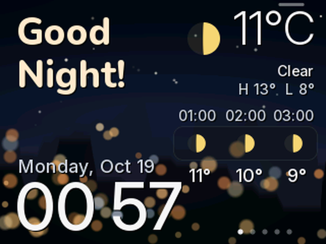
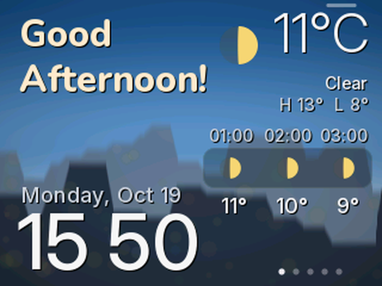
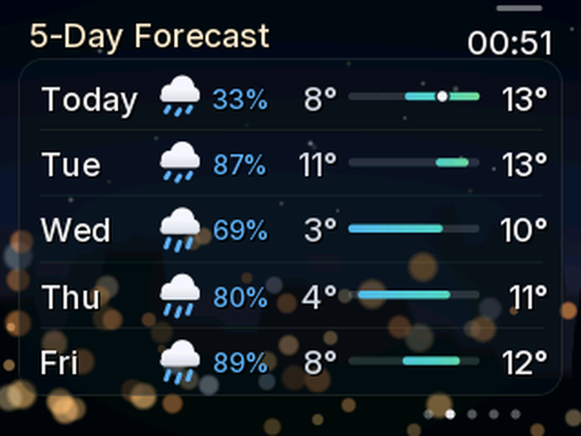
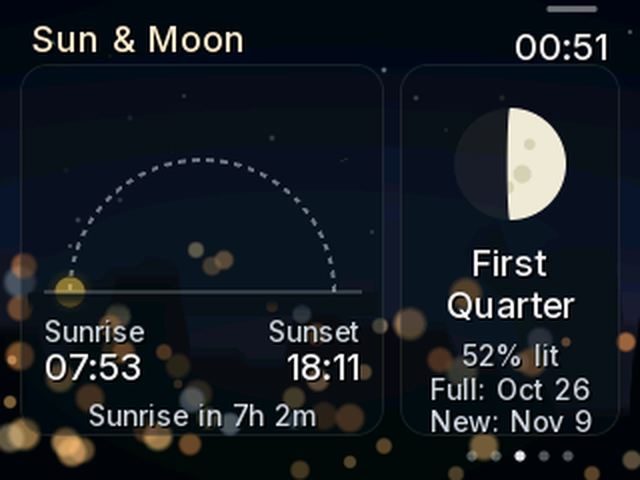
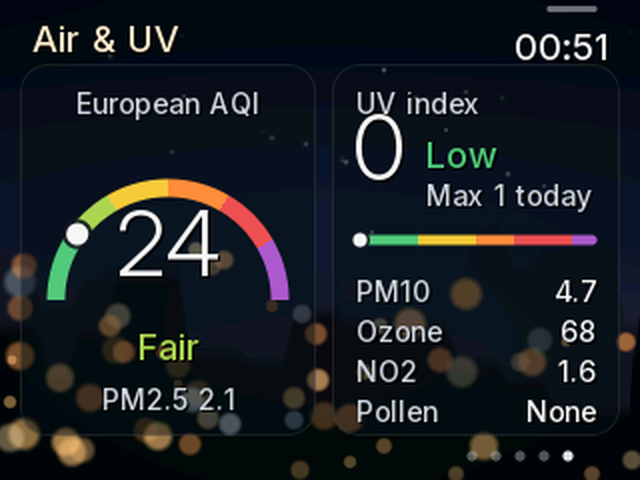
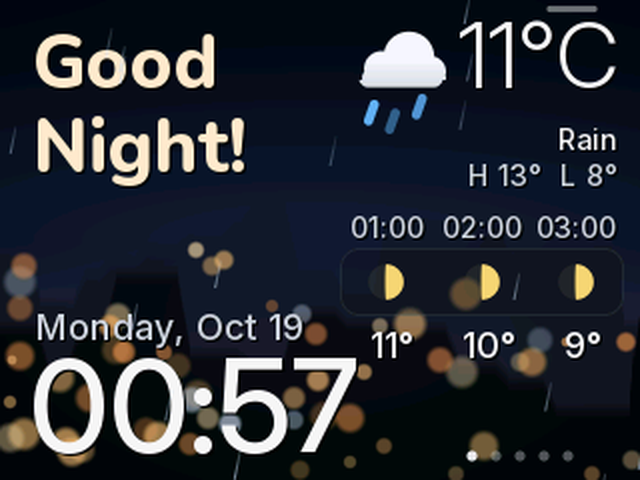
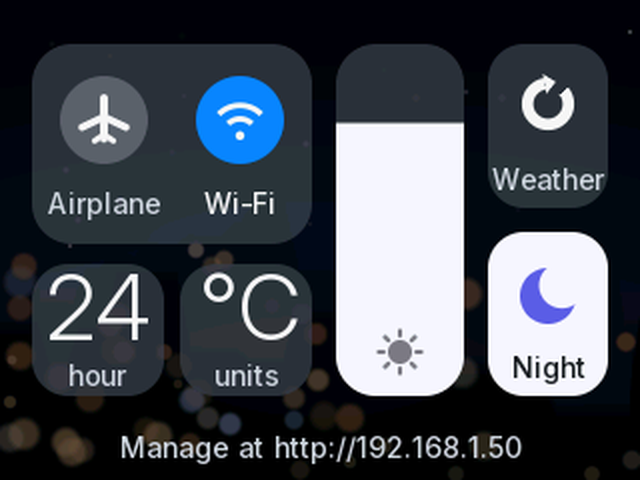
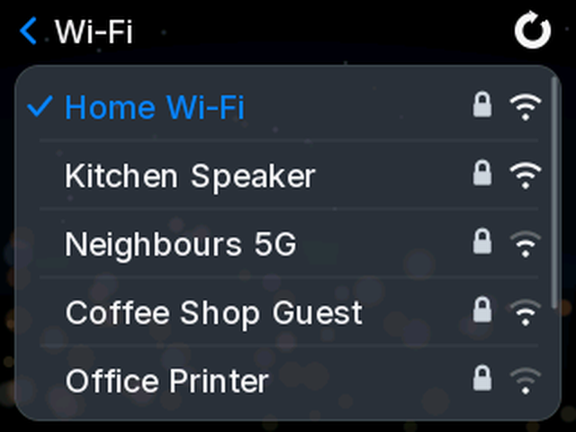

# CYD Dashboard

A weather and clock dashboard for the **ESP32-2432S028R "Cheap Yellow Display"** (CYD).

It greets you by time of day and shows the time, date and current weather, with an hourly forecast. Swipe sideways for a 5-day forecast, sun and moon, rain and air-quality pages. Rain, snow and thunderstorms are animated on screen, and the RGB LED on the back glows to match the weather.

Swipe down from the top-right corner for an iPhone-style control center. You can also manage the dashboard from a web page in your browser, including uploading your own background photos.

<p align="center">
  
  
</p>

<p align="center">
  
  
  
</p>

<p align="center">
  
  
  
</p>

> Screenshots are taken straight from the device over USB (shown at 2× size). Network names in the Wi-Fi screenshot are placeholders.

---

## Contents

- [Hardware](#hardware)
- [Features](#features)
- [Installing / flashing](#installing--flashing)
- [First start-up](#first-start-up)
- [Using it](#using-it)
- [Web management page](#web-management-page)
- [How it works](#how-it-works)
- [Customising](#customising)
- [Known issues and limitations](#known-issues-and-limitations)
- [Troubleshooting](#troubleshooting)
- [Project layout](#project-layout)
- [Credits and licences](#credits-and-licences)

---

## Hardware

This firmware is made for the **ESP32-2432S028R**, the original "Cheap Yellow Display":

| Part | Details |
|---|---|
| Board | ESP32-2432S028R (yellow PCB, ESP32-WROOM-32, 4 MB flash, no PSRAM) |
| Screen | 2.8" 320×240 TFT, **ILI9341** driver, on the HSPI bus |
| Touch | **XPT2046** resistive touch controller, on its own (VSPI) pins |
| USB | **one micro-USB** port (CH340 USB-serial chip) |
| Also used | RGB LED on the back (GPIO 4/16/17), BOOT button (GPIO 0) |

It was developed and tested on a single-USB (micro-USB) board.

**Other CYD versions.** Some newer boards are sold as "CYD2USB", with both USB-C and micro-USB. They often use an **ST7789** display, or need different colour-inversion settings. On those boards the display may show wrong or inverted colours, or nothing at all. This firmware hasn't been tested on them. If you have one, try one of these in `platformio.ini`:
- swap `-DILI9341_2_DRIVER=1` for `-DST7789_DRIVER=1`
- remove `-DTFT_INVERSION_ON=1`

### Pin map

| Function | Pins |
|---|---|
| TFT (HSPI) | MOSI 13, MISO 12, SCLK 14, CS 15, DC 2, backlight 21 |
| Touch (VSPI) | CLK 25, MOSI 32, MISO 39, CS 33, IRQ 36 |
| RGB LED (active-low) | red 4, green 16, blue 17 |
| BOOT button | 0 |

---

## Features

### Home screen
- **Greeting** by time of day: "Good Morning / Afternoon / Evening / Night!".
- **Large clock** whose colon blinks every second. **Tap the clock** to switch between 12- and 24-hour time.
- **Date**, shortened automatically if it doesn't fit.
- **Current weather:** an icon, the temperature, the condition, and today's high and low. Your town is shown too if there's room. **Tap the temperature** to switch between °C and °F.
- **Next 3 hours** forecast strip.
- **Background** changes with the time of day: morning, afternoon, evening or night. Each is a softly blurred city skyline with glowing "bokeh" lights. You can upload your own photo for each time of day.
- **Night sky:** twinkling stars on clear nights.
- **Moon icons** show the **real current moon phase** at night.

### Swipe pages
Swipe **left / right** to move between the pages. The dots at the bottom right show where you are, and the screen goes back to the home page after 2 minutes.

| Page | What it shows |
|---|---|
| **5-Day Forecast** | Day, icon, chance of rain, and low/high temperatures. A coloured bar shows each day's range on a shared scale (blue = cold, orange = hot), with a dot marking the current temperature. |
| **Sun & Moon** | An arc from sunrise to sunset with the sun at its current position, plus sunrise and sunset times and how much daylight is left (or the time until sunrise). Also a moon drawn in its real phase, with the phase name, how much is lit, and the next full and new moon dates. |
| **Rain** | Chance of rain for each of the next 12 hours, as a bar chart. Darker bars mean heavier rain. A one-line summary says something like "Rain likely around 3 PM", "Rain easing by 6 PM" or "No rain expected", with the total amount expected. |
| **Air & UV** | An air-quality gauge (European AQI inside Europe, US AQI elsewhere), the UV index now and today's maximum on a coloured scale, and PM2.5, PM10, ozone, NO₂ and pollen. |

### Animated weather
- **Rain and drizzle:** streaks fall across the screen. Heavier rain means more drops.
- **Snow:** flakes drift down and sway.
- **Thunderstorm:**
  - heavy rain
  - the **screen backlight flashes** like lightning every few seconds
  - the lightning bolt in the icon lights up
- **Main weather icon:**
  - the sun's rays slowly turn
  - clouds drift
  - rain and snow fall from the cloud
- **Clear nights:** stars twinkle.
- **Speed:** animations run at about 17–20 frames per second. Turn them off from the web page if you prefer a still screen.

### Ambient LED
The RGB LED on the back of the board glows to match the weather:

| Weather | LED |
|---|---|
| Sunny / mainly clear (day) | warm orange-yellow |
| Clear night | soft blue |
| Partly cloudy, overcast, fog | static white |
| Rain, drizzle, showers | breathing blue |
| Snow | slow, icy breathing |
| Thunderstorm | white flashes, in time with the on-screen lightning |

The LED's brightness can be set from the web page, and it dims to 30% during night hours. It can be turned off.

### Control center
**Swipe down from the top-right corner**, where the small bar is, to open the control center:
- **Airplane mode:** turns the radio off.
- **Wi-Fi:**
  - **tap** to turn it on or off
  - **press and hold** to choose a network
- **12/24-hour** and **°C/°F** buttons.
- **Brightness slider:** drag it up or down. It changes the daytime or night-time brightness, whichever is active now.
- **Weather:** refresh it now.
- **Night:** turn automatic night dimming on or off.
- The bottom line shows the web address for managing the dashboard.

Swipe up or tap outside the buttons to close it. It closes by itself after 20 seconds.

### Wi-Fi network picker
In the control center, **press and hold the Wi-Fi button** (about 2/3 of a second):
- **The list:** nearby networks appear strongest first, each with a padlock if it needs a password and a signal-strength icon. Your current network has a tick.
  - Drag up or down to scroll.
  - The arrow at the top right scans again, and **‹ Wi-Fi** goes back.
- **Open networks** connect when you tap them.
- **Password-protected networks** open an **on-screen keyboard**.
  - Shift gives one capital letter. **123** switches to numbers and symbols, and **#+=** to more symbols, so every printable character is available.
  - Holding backspace keeps deleting.
  - Tap **Join** to connect.
- **After joining:** you see a confirmation, the dashboard comes back and the weather updates. The new network is saved and used after a restart.
- **If joining fails:** a wrong password takes you back to the keyboard with your text kept. In either case the dashboard **reconnects to your previous network**, so a failed attempt doesn't leave it offline.

### Web management page
Open the device's address in a browser, for example `http://192.168.1.50/` or `http://cyd-dashboard.local/`. See [below](#web-management-page) for details.

---

## Installing / flashing

### What you need
- The CYD board and a **data-capable** micro-USB cable. Some cables only carry power.
- A computer running macOS, Windows or Linux.
- **PlatformIO**: either the [VS Code extension](https://platformio.org/install/ide?install=vscode), or the command-line tool:
  ```bash
  python3 -m pip install -U platformio
  ```
- A **USB driver for the CH340** chip:
  - built in on recent macOS and Linux
  - on Windows, install the [WCH CH340 driver](https://www.wch-ic.com/downloads/CH341SER_EXE.html) if the board doesn't show up as a COM port

### Build and flash
```bash
git clone https://github.com/Orlin12/cyd-dashboard.git
cd cyd-dashboard
pio run -t upload
```

PlatformIO downloads the ESP32 toolchain and all libraries the first time, which takes a few minutes. It then builds the firmware and flashes it to the board over USB.

- **Choosing the port:** if you have several serial devices, add `--upload-port /dev/cu.usbserial-XXXX` on macOS, `/dev/ttyUSB0` on Linux, or `COM5` on Windows.
- **Opening the serial monitor:** `pio device monitor` (115200 baud).
- **In VS Code:** open the folder and click **PlatformIO → cyd → Upload**.

### Notes on flashing
- Upload speed is set to **460800** baud. The cheap CH340 chips are unreliable at 921600 ("Invalid head of packet" errors).
- If the upload can't connect, **hold the BOOT button** while it says "Connecting...", then let go. Most CYDs enter flash mode automatically.
- The project uses the `huge_app.csv` partition table: 3 MB for the app and about 900 KB of storage for background images.
- To wipe all saved settings, Wi-Fi details and backgrounds:
  ```bash
  pio run -t erase
  ```
  Flash again afterwards.

---

## First start-up

1. **Hotspot:** the screen says **"WiFi Setup"** and the board creates a Wi-Fi hotspot called **`CYD-Dashboard`**.
2. **Join it:** connect your phone or laptop to that hotspot. A setup page should open automatically. If it doesn't, browse to `http://192.168.4.1`.
3. **Pick your network:** choose your home Wi-Fi and enter its password. It must be **2.4 GHz**, because the ESP32 can't use 5 GHz.
4. **Done:** the board connects and sets its clock from the internet. It works out your location from your internet connection and fetches the weather. That takes a few seconds.

**Changing networks later:** do it from the control center by holding the Wi-Fi button. To clear the saved network completely, hold the **BOOT button while plugging it in**, or use **Forget Wi-Fi** on the web page.

---

## Using it

| Gesture | Where | Action |
|---|---|---|
| Tap the clock | Home | 12 h ⇄ 24 h |
| Tap the temperature | Home | °C ⇄ °F |
| Swipe left / right | Any page | Next / previous page |
| Swipe down from the top-right corner | Any page | Open the control center |
| Swipe up, or tap outside the buttons | Control center | Close it |
| Drag the slider | Control center | Brightness |
| Press and hold Wi-Fi | Control center | Choose a Wi-Fi network |

**If touches land in the wrong place,** use **Calibrate touch** on the web page and tap the two targets.

---

## Web management page

Browse to the address shown at the bottom of the control center, for example `http://192.168.1.50/`, or to `http://cyd-dashboard.local/` (mDNS).

- **Live screen:**
  - a picture of what the display shows right now
  - buttons to preview each time of day for 20 seconds
  - buttons to jump to a page
  - **Try a weather effect:** shows sunny, cloudy, rain, snow or storm for 30 seconds, so you can see the animations and LED colours without waiting for the weather
- **Weather:** temperature, condition, high and low, "feels like", sunrise and sunset, air quality, UV, moon phase and when it last updated. **Update now** fetches it again.
- **Backgrounds:** upload a photo for each time of day (morning, afternoon, evening, night).
  - The editor lets you drag and zoom the crop, and darken or blur the photo so the text stays readable, with a preview of the text on top.
  - You can apply one photo to all four slots.
  - The photo is converted in your browser and stored on the device.
  - **Reset** goes back to the built-in background.
- **Display:**
  - 12/24 h and °C/°F
  - day and night brightness
  - night dimming on/off and night hours
  - screen orientation (normal or upside down)
- **Location & weather:** automatic location (from your IP address), or a manually entered latitude, longitude and place name. Also whether the place name is shown, and how often the weather updates (5–240 minutes).
- **Effects:** weather animations on/off, ambient LED on/off, LED brightness.
- **Device:**
  - device time, Wi-Fi signal, uptime, free memory, storage use and firmware version
  - **Calibrate touch**, **Restart** and **Forget Wi-Fi**

Settings save straight away and are kept on the device when it's switched off.

### HTTP API
The page uses a small JSON API that you can call yourself:

| Method & path | Purpose |
|---|---|
| `GET /api/status` | Device info, current weather, sun times, AQI, UV, moon phase |
| `GET /api/settings` | All settings |
| `POST /api/settings` | Change settings: send a JSON object with any of the keys `GET` returns |
| `GET /screen.bmp` | Screenshot of the display (`?bg=0..3` for a background only) |
| `POST /api/bg?slot=0..3` | Upload a background (multipart, a raw 320×240 RGB565 big-endian file of 153,600 bytes) |
| `DELETE /api/bg?slot=0..3` | Remove a custom background |
| `POST /api/action?do=…` | `refresh`, `preview&hour=H`, `weather&code=N` (`-1` to stop), `page&n=0..4`, `calibrate`, `reboot`, `forget` |

---

## How it works

### Data sources
- **Weather:** [Open-Meteo](https://open-meteo.com/), free, with no account or API key. It provides current conditions, the next 24 hours and 6 days of daily forecast. The board fetches this every 15 minutes by default.
- **Air quality:** the [Open-Meteo Air Quality API](https://open-meteo.com/en/docs/air-quality-api), fetched after each weather update.
- **Location:** [ip-api.com](https://ip-api.com/), which estimates your town and coordinates from your public IP address. It's only used when automatic location is on.
- **Time:** NTP (`pool.ntp.org`, Google, Cloudflare). The time zone comes from Open-Meteo's `timezone=auto`, so it follows your location and daylight-saving time automatically.
- **Moon phase:** calculated on the device from the date (mean synodic month of 29.53 days), so it needs no internet.

### Rendering
The ESP32 doesn't have enough RAM for a full-screen frame buffer (320×240×2 = 150 KB), so the screen is drawn in **strips of 320×40 pixels**:
- Each strip is drawn into a 25 KB buffer: background first, then anti-aliased shapes and text, then any rain or snow on top. It's then sent to the display.
- **Shapes:** icons, cards and the gauge are drawn with per-pixel coverage maths, which gives smooth edges without needing image files.
- **Text:** the fonts are anti-aliased bitmaps stored in flash. The firmware draws them itself, glyph by glyph, so it can draw just part of a letter when only a small area needs updating.
- **Animations:** only the small rectangles that changed get redrawn. For each moving raindrop, that's just the area it moved through. A full screen takes about 120–200 ms to draw, but a raindrop's rectangle takes about 1–2 ms.
- **The weather icon:** the background behind it is kept in a small buffer, so the icon can be animated without recalculating the sky.

### Storage
- **Settings and Wi-Fi details:** in the ESP32's NVS (flash key-value store), namespace `dash`.
- **Background photos:** raw 320×240 RGB565 files (`/bg0.raw` … `/bg3.raw`) on the LittleFS partition.
- **The web page:** gzip-compressed and built into the firmware. `tools/embed_web.py` does this automatically at every build.

---

## Customising

- **`src/config.h`:** factory defaults: °C/°F, 12/24 h, rotation, brightness, night hours, refresh interval, setup hotspot name, mDNS name and touch pins. Most of these can also be changed from the web page.
- **`web/index.html`:** the management page. Edit it and rebuild; it's embedded automatically.
- **Fonts:** `src/fonts.h` is generated by `tools/make_fonts.py` from **Inter** and **Nunito**. The script downloads them the first time it runs. To change sizes, weights or the character set:
  ```bash
  python3 -m pip install pillow
  python3 tools/make_fonts.py
  ```
- **Screenshots:** `tools/screenshot.py PORT out.png [hour|--] [command]` saves a PNG of the screen over USB.

### Serial commands (115200 baud, for testing)
| Send | Effect |
|---|---|
| `S` | Dump a screenshot (used by `tools/screenshot.py`) |
| `h07` / `h--` | Preview 07:00 / back to real time |
| `p0`…`p4` | Show page 0–4 |
| `w61` / `w--` | Preview weather code 61 (WMO codes) for 30 seconds / back to real weather |
| `c` | Open the control center (next redraw) |
| `n` | Open the Wi-Fi network list |
| `k` | Open the keyboard with sample text |

---

## Known issues and limitations

- **No security on the web page.** Anyone on your network can change settings, upload backgrounds or make it forget its Wi-Fi. Only use it on a network you trust.
- **No battery-backed clock.** If the board starts with Wi-Fi off (airplane mode saved), it has no way to know the time. The clock shows `--:--` until Wi-Fi is back on.
- **2.4 GHz Wi-Fi only.** Hidden networks and enterprise (WPA2-Enterprise / 802.1X) networks can't be joined from the network picker.
- **Rain and snow are drawn in front of the text,** not behind it. That keeps the animation fast enough on this hardware.
- **Animations pause briefly** while the whole screen redraws (once a minute, when you change page, etc.) and while your finger is on the screen.
- **Short Wi-Fi interruption:** scanning for networks briefly pauses Wi-Fi. If the board wasn't connected, its first scan is often thrown away and retried, so the list can take 3–5 seconds to appear.
- **Joining a network with the wrong password** takes up to 15 seconds to give up. The ESP32 doesn't always report a wrong password straight away.
- **Password visible while typing:** the on-screen keyboard shows the password in plain text, because mistakes on the small keys are easy to make.
- **Touch accuracy:** the resistive touch screen varies from board to board. Run **Calibrate touch** if taps land in the wrong place, and press firmly. Small keys on the keyboard can need a deliberate tap.
- **Location by IP address** can be wrong: VPNs, mobile networks and some internet providers can make it report a city far away. Turn off automatic location and enter your coordinates on the web page if that happens.
- **Air-quality scale:** it's chosen by a simple location box (European AQI inside Europe, US AQI elsewhere). Pollen data is only available in Europe and shows "n/a" elsewhere.
- **The moon phase** uses an average lunar month, so phase changes can be off by up to about half a day.
- **Plain HTTP:** weather and location requests use plain HTTP, which keeps memory use low. The data isn't private, but it isn't encrypted either.
- **Lightning flashes** briefly turn the backlight up, even at night. The flash is limited relative to the current brightness, but you can turn animations off if it bothers you.
- **Boot log noise:** on boards without custom backgrounds, the serial log shows harmless `open(): /littlefs/bgN.raw does not exist` errors at start-up.
- **Opening the serial port may reset the board,** depending on your serial tool's DTR/RTS handling.
- **Other CYD versions** (ST7789 / two-USB boards) are untested and need the driver change described under [Hardware](#hardware).

---

## Troubleshooting

| Problem | Try |
|---|---|
| Colours look inverted (e.g. a blue sky looks orange) | Remove or add `-DTFT_INVERSION_ON=1` in `platformio.ini` |
| Screen stays white or black | You probably have an ST7789 board; see [Hardware](#hardware) |
| Board doesn't appear as a serial port | Use a data cable; install the CH340 driver (Windows) |
| Upload fails with "Invalid head of packet" | Keep `upload_speed = 460800` or lower it to 115200 |
| Upload can't connect | Hold BOOT during "Connecting..." |
| "Fetching weather..." never changes | Check the board's internet access; look at `pio device monitor` for HTTP errors |
| Wrong town or weather | Turn off automatic location on the web page and enter coordinates |
| Touches land in the wrong place | Web page → **Calibrate touch** |
| Can't reach the web page | Use the IP shown in the control center; `.local` names don't work on some Android devices and networks |
| Need to start completely fresh | Run `pio run -t erase`, then flash again |

---

## Project layout

```
cyd-dashboard/
├── platformio.ini        board, libraries, display pins and settings
├── src/
│   ├── main.cpp          the whole firmware
│   ├── config.h          factory defaults and pins
│   ├── fonts.h           generated anti-aliased fonts (Inter, Nunito)
│   └── web_index.h       generated at build time from web/index.html (not committed)
├── web/
│   └── index.html        the management web page
├── tools/
│   ├── embed_web.py      PlatformIO pre-build step: gzip and embed the web page
│   ├── make_fonts.py     regenerate src/fonts.h
│   └── screenshot.py     grab a PNG of the screen over USB
└── docs/                 screenshots for this README
```

---

## Credits and licences

- **Code:** [MIT licence](LICENSE).
- **Libraries:** [TFT_eSPI](https://github.com/Bodmer/TFT_eSPI), [WiFiManager](https://github.com/tzapu/WiFiManager), [ArduinoJson](https://arduinojson.org/), [XPT2046_Touchscreen](https://github.com/PaulStoffregen/XPT2046_Touchscreen) and the Arduino core for ESP32, each under its own licence.
- **Weather and air-quality data:** [Open-Meteo.com](https://open-meteo.com/), licensed under [CC BY 4.0](https://creativecommons.org/licenses/by/4.0/). Open-Meteo is free for non-commercial use.
- **Location:** [ip-api.com](https://ip-api.com/), whose free tier is for non-commercial use.
- **Fonts:** [Inter](https://github.com/rsms/inter) and [Nunito](https://github.com/googlefonts/nunito), both under the [SIL Open Font License 1.1](https://openfontlicense.org/). `src/fonts.h` contains bitmaps generated from them.
